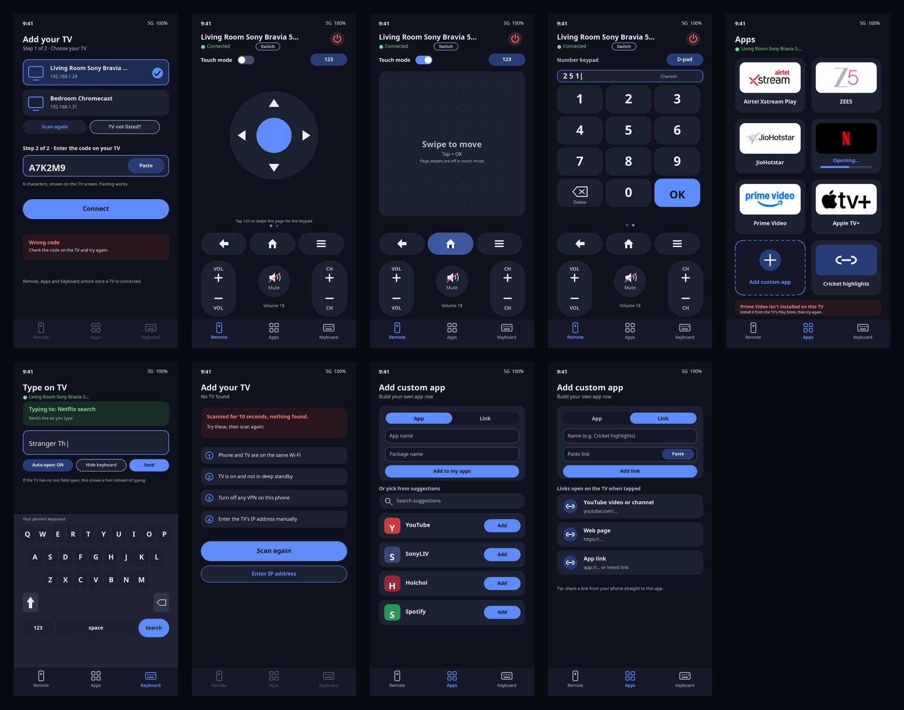
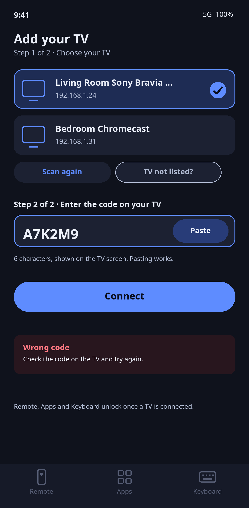
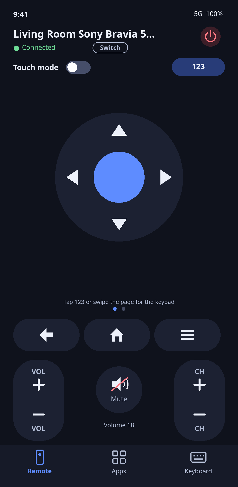
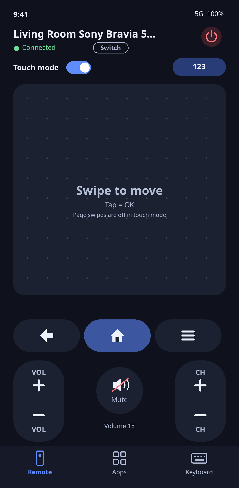
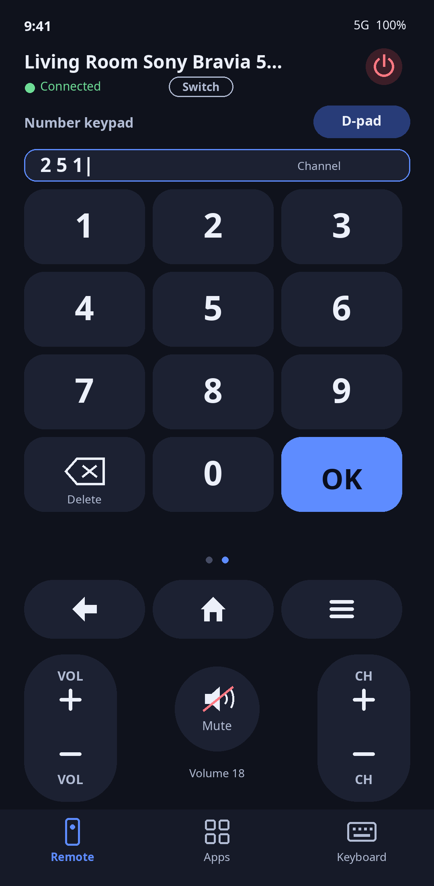
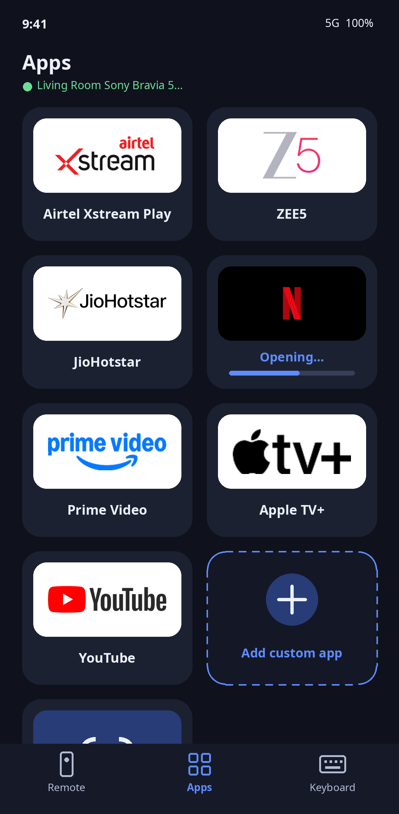
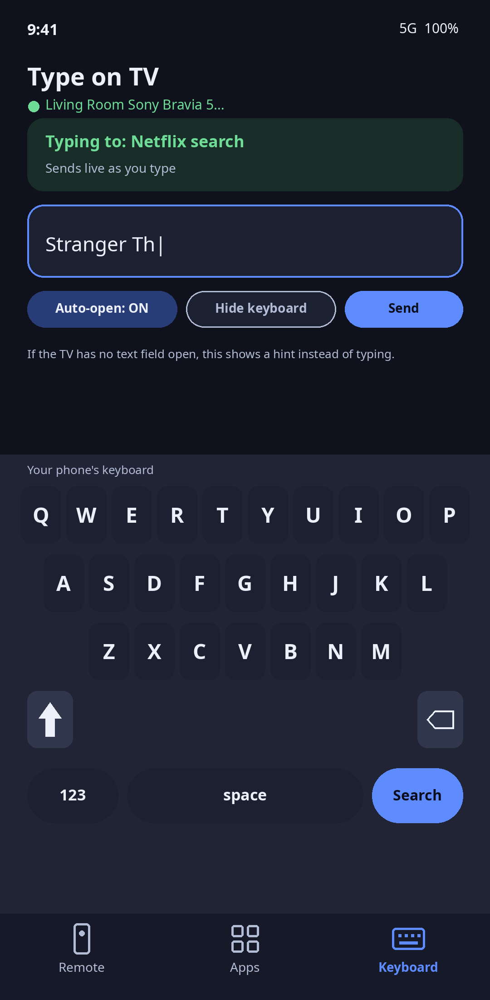
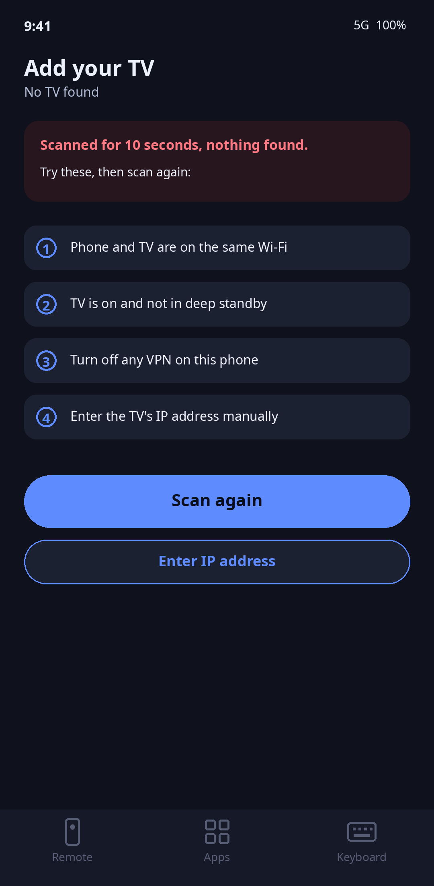
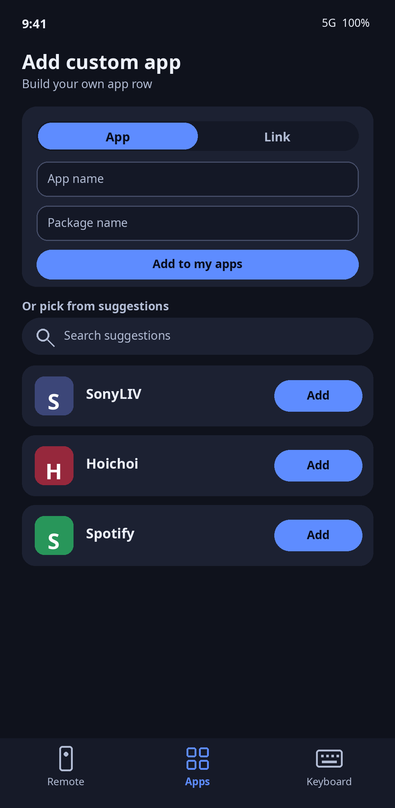
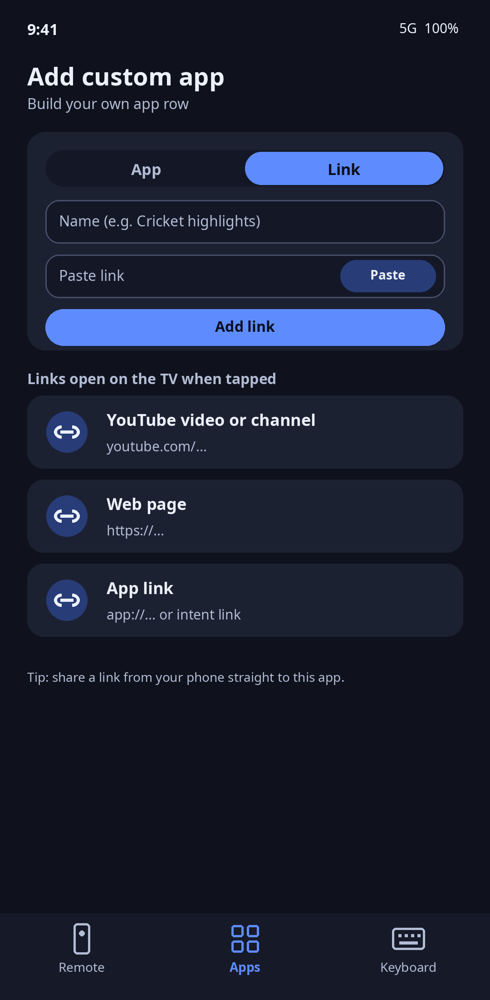

# TV Remote

### Your phone, but a better Android TV remote. Built entirely by an AI agent, in about an hour.

No human wrote a line of this. Built with **[Instinct](https://instinct.com)**, the AI agent, and the team behind it, which made this possible. One chat, one agent: scoping, ten rounds of design mocks, a from-scratch implementation of the Android TV Remote v2 protocol, the UI, a signed APK, tests, and this repo. Then it was paired with a real TV and fixed live from real-TV feedback.

**Tested on a real TV.** Paired, connected and controlling an Airtel Xstream box. Remote keys, VOL, mute, app launching and the keyboard all run on real hardware.

## What it does
- **Pair in seconds** with the code your TV shows
- **Remote, touch and keypad.** D-pad, a touchpad mode, and a number pad one swipe away
- **Big VOL and CH pills** with a live volume readout, hold to repeat
- **Apps grid** with real logos: Airtel Xstream, ZEE5, JioHotstar, Netflix, Prime Video, Apple TV+, YouTube. Add your own apps or any link
- **Type on your phone.** The keyboard opens when you tap a text field on the TV, and stays out of the way otherwise
- **Honest errors.** If the TV rejects a launch, you see exactly what was sent

## How it was built
- Original code and design, plain Java and Android views. No Gradle, no third-party libraries
- Our own protocol client: TLS pairing on port 6467, remote on port 6466, protobuf messages by hand
- Checked against an independent open-source implementation (a mock TV built on `androidtvremote2`), plus unit tests and a Robolectric UI run of the real activity
- Shipped as signed releases, then iterated from the owner's real-TV reports: v1.0 to v1.2 in the same sitting

Good to know: Netflix, YouTube and Prime Video tiles launch on the test TV. Xstream and ZEE5 depend on which package names the TV has installed (editable with a long-press on a tile).

Brand logos are from Wikimedia Commons. Trademarks belong to their owners.

## Design

| Add your TV (pairing) | Remote | Touch mode |
|---|---|---|
|  |  |  |

| Keypad | Apps | Keyboard |
|---|---|---|
|  |  |  |

| No TV found | Add custom app | Add custom link |
|---|---|---|
|  |  |  |

## Release notes
- **v1.4**: buttons and the D-pad send on release only, and only if the finger did not travel, so sliding across them never presses anything (hold still to repeat); new Last channel button next to Mute (sends KEYCODE_LAST_CHANNEL, 229).
- **v1.3**: always opens on the Remote tab; keyboard auto-open now needs a text field to stay focused for 1.2 s with no commands sent, and any key (D-pad and OK included) or app launch suppresses it for 6 to 10 s; keypad and other buttons fire only on clean taps (a swipe that starts on a button no longer presses it); pages slide with your finger; mute icon no longer clipped.
- **v1.2**: keyboard no longer jumps in after Home, Back, volume or an app launch; Menu button removed, Back, Home and Mute bigger, "Mute" caption gone; Xstream tile tries `com.airtel.tv` then `tv.airtel.xstream.tvapp`; every tile ends with a Play Store fallback.
- **v1.1**: opens on the Remote tab, swipe to keypad works anywhere, keypad digits clear after 2.5 s, bigger VOL/CH pills, deep-link-first app launching, visible launch and rejection messages.
- **v1.0**: first build.

Note: the mocks above are the original design; the built layout differs slightly (no Menu button, no suggestions list under Add custom app, no "not installed" banner).

## Build
No Gradle. Needs JDK 17 and the Android SDK (platform 34, build-tools 34.0.0) at the paths in `build.sh`.
`./build.sh` produces a signed `build/TVRemote.apk` (it creates a keystore on first run; keep it so later builds can update the installed app).

## Tests
- `test/run_protocol_test.sh`: the Java pairing and remote client against a mock TV (Python, built on the open-source `androidtvremote2` protobuf definitions as an independent check of the wire format).
- `test/UnitTests.java`: text diff, custom app storage, link and package validation.
- `rob/run_ui_test.sh`: Robolectric run of the real activity against the mock TV (pairing, wrong code, d-pad, touch pad, keypad, bottom buttons, apps, custom link, keyboard auto-open and live typing).

## Credits
Built with [Instinct](https://instinct.com) - the AI agent that designed, coded, tested and shipped this app, and the team behind it that made it possible. Idea, direction and real-TV testing by Mallikarjun Jamadarkhani.
