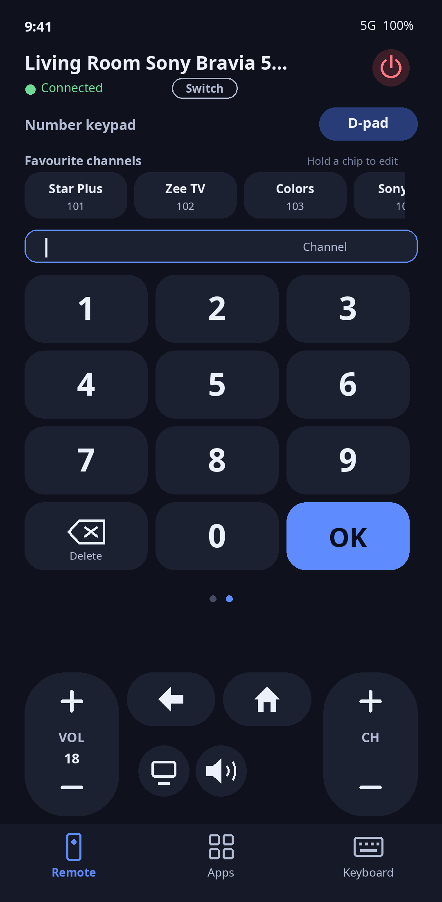

# TV Remote

### This app was built using WhatsApp. An AI agent took it from first idea to finished app within 2 hours.

An Android TV remote for your phone, designed, coded, tested and shipped through one WhatsApp conversation. No laptop, no IDE: the owner sent ideas, screenshots and real-TV feedback from his phone, and the Instinct agent answered with design mocks, code, tests and a new signed APK each round. Agentic-coded, from ideation to the final complete app, within 2 hours, and tested on a real TV along the way.

**Tested on a real TV.** Paired, connected and controlling an Airtel Xstream box. Remote keys, volume, mute, Netflix, YouTube and Prime Video launching, and the keyboard all run on real hardware.

## What it does
- **Pair in seconds** with the code your TV shows
- **Remote, touch and keypad.** D-pad, a touchpad mode, and a number pad one swipe away; pages slide with your finger
- **Big VOL and CH pills** with a live volume readout, plus Back, Home, Mute and a Last channel button
- **Favourite channels.** Save channels as chips on the keypad page, tap to jump
- **Apps grid** with real logos: Airtel Xstream, ZEE5, JioHotstar, Netflix, Prime Video, Apple TV+, YouTube. Add your own apps or any link
- **Type on your phone.** The keyboard opens when you tap a text field on the TV, and stays out of the way otherwise
- **Honest errors.** If the TV rejects a launch, you see exactly what was sent

## How it was built
- **Over WhatsApp.** Every design round, review and fix happened in the chat
- Original code and design in plain Java and Android views. No Gradle, no third-party libraries
- Our own protocol client: TLS pairing on port 6467, remote on port 6466, protobuf messages by hand
- Checked against an independent open-source implementation (a mock TV built on `androidtvremote2`), plus unit tests and a Robolectric UI run of the real activity
- Shipped as signed releases and iterated from real-TV reports: v1.0 to v1.5 in the same sitting

Good to know: Xstream and ZEE5 tiles depend on which package names the TV has installed (editable with a long-press on a tile).

Brand logos are from Wikimedia Commons. Trademarks belong to their owners.

## Screens

| Pairing | Remote | Keypad with favourites | Apps | Keyboard |
|---|---|---|---|---|
|  |  |  |  |  |

These are the design mocks, one per page. The built app differs slightly: no Menu button, a Last channel button next to Mute, and no "not installed" banner.

## Release notes
- **v1.5**: favourite channels on the keypad page: a chip row above the digits, hold to save a name and channel number (prefilled from what you typed), tap a chip to send its digits then OK, hold a chip to edit or delete.
- **v1.4**: buttons and the D-pad send on release only, and only if the finger did not travel, so sliding across them never presses anything (hold still to repeat); new Last channel button next to Mute (sends KEYCODE_LAST_CHANNEL, 229).
- **v1.3**: always opens on the Remote tab; keyboard auto-open now needs a text field to stay focused for 1.2 s with no commands sent, and any key (D-pad and OK included) or app launch suppresses it for 6 to 10 s; keypad and other buttons fire only on clean taps (a swipe that starts on a button no longer presses it); pages slide with your finger; mute icon no longer clipped.
- **v1.2**: keyboard no longer jumps in after Home, Back, volume or an app launch; Menu button removed, Back, Home and Mute bigger, "Mute" caption gone; Xstream tile tries `com.airtel.tv` then `tv.airtel.xstream.tvapp`; every tile ends with a Play Store fallback.
- **v1.1**: opens on the Remote tab, swipe to keypad works anywhere, keypad digits clear after 2.5 s, bigger VOL/CH pills, deep-link-first app launching, visible launch and rejection messages.
- **v1.0**: first build.

## Build
No Gradle. Needs JDK 17 and the Android SDK (platform 34, build-tools 34.0.0) at the paths in `build.sh`.
Set a keystore password, then build: `KS_PASS=yourpassword ./build.sh`. It produces a signed `build/TVRemote.apk` and creates a keystore on first run; keep that keystore (and its password) so later builds can update the installed app.

## Tests
- `test/run_protocol_test.sh`: the Java pairing and remote client against a mock TV (Python, built on the open-source `androidtvremote2` protobuf definitions as an independent check of the wire format).
- `test/UnitTests.java`: text diff, custom app and favourite storage, link and package validation.
- `rob/run_ui_test.sh`: Robolectric run of the real activity against the mock TV (pairing, wrong code, d-pad, touch pad, keypad, bottom buttons, apps, custom link, keyboard auto-open and live typing).

## License
MIT. See [LICENSE](LICENSE). Copyright (c) 2026 Mallikarjun Jamadarkhani.

## Credits
Built with [Instinct](https://instinct.com): the Instinct agent that designed, coded, tested and shipped this app, and the Instinct team who gave Mallikarjun Jamadarkhani the access to try it out. Idea, direction and real-TV testing by Mallikarjun Jamadarkhani.
